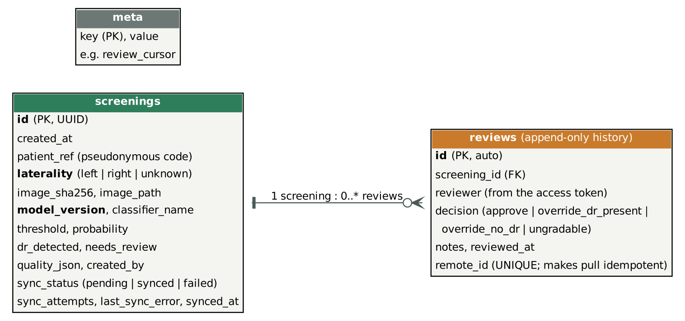

# Architecture

Corrected after the supervisor's review so that **offline inference, cloud synchronisation and authentication are reconciled**,
and so that the diagrams retain the **image, laterality, model version and review history**.

## Principle: local first, cloud second

Screening never depends on the network. The clinic app runs the model locally and **writes the record to the local
store before anything else**. The network is only used by `SyncService`, which can fail at any moment without losing data.

| Concern | Decision |
|---|---|
| Offline inference | `ScreeningService` -> `BaseClassifier` (Keras or TFLite), no network calls |
| Local data | SQLite + image files; each record keeps image, laterality, model version, classifier, threshold, score, quality notes |
| Synchronisation | Push pending records (idempotent by UUID), then pull reviews after a cursor (idempotent by remote id). A connection failure stops the cycle without counting an attempt; a 4xx rejection marks only that record FAILED |
| Authentication | `Authorization: Bearer <token>`; tokens map to a user and a role; the reviewer name comes from the token, never from the request body |
| Authorisation | clinician uploads; specialist lists cases, reads images, writes reviews; admin reads statistics |
| Review history | `reviews` is append-only; a second opinion adds a row instead of replacing the first |
| Integrity | the image SHA-256 travels with the upload and is verified by the server |

## Use cases

## Data model

## Sync sequence (offline -> online)

1. Health worker screens a patient. The app saves the record as `pending`.
2. The connection is down. `Sync now` tries once, gets "unreachable", reports "Offline", leaves everything `pending`.
3. The connection returns. `Sync now` uploads each pending record; the server stores it (a repeat upload changes nothing).
4. The specialist lists cases that need review, opens one, and submits a decision (stored with their identity and time).
5. The clinic's next sync pulls reviews after its stored cursor and attaches them to the matching local records.

## Differences from the proposal (and why)

| Proposal | Delivered | Reason |
|---|---|---|
| React Native Android app | Streamlit clinic app | Build and test the whole workflow within the semester |
| FastAPI + PostgreSQL | Standard-library REST server + SQLite behind `ScreeningRepository` | No extra services to install; same REST contract |
| React specialist dashboard | Streamlit specialist portal | As above |
| Load balancer | Not built | Single-process prototype |
| Patient name and date of birth | Pseudonymous patient code | Data minimisation |
