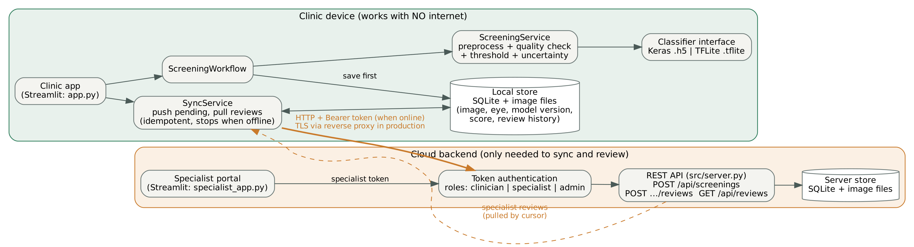
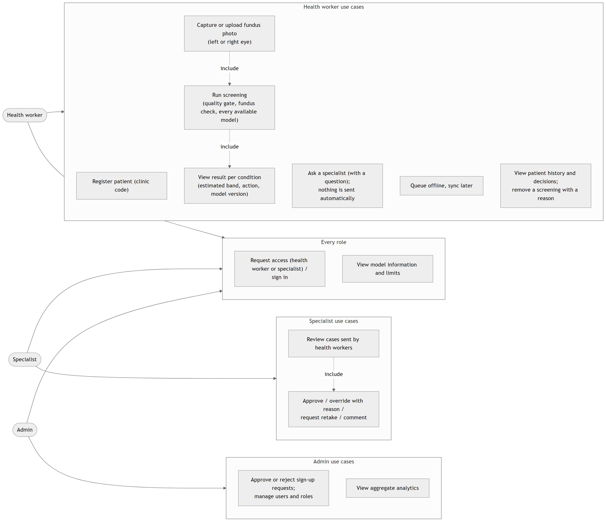
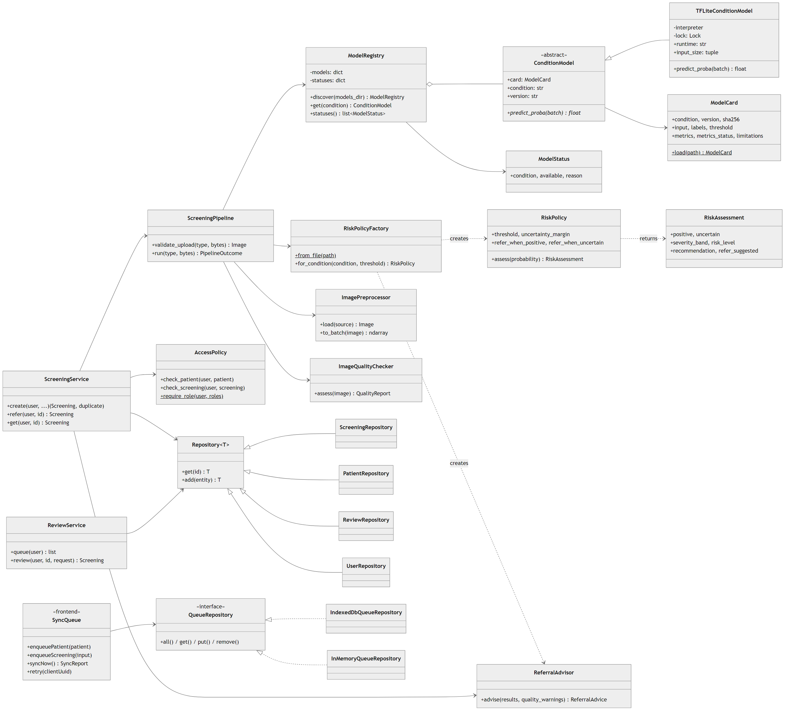
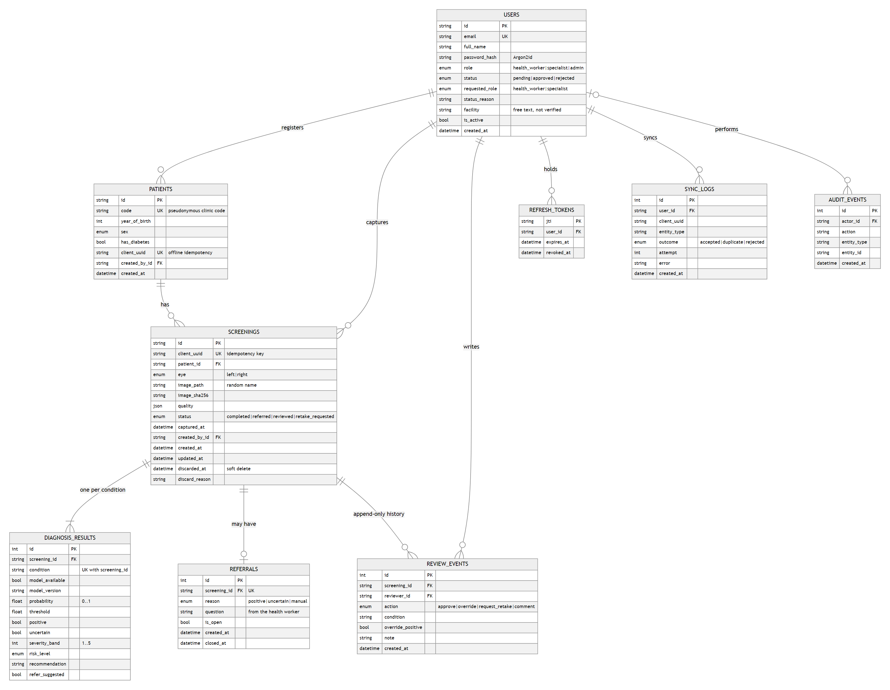
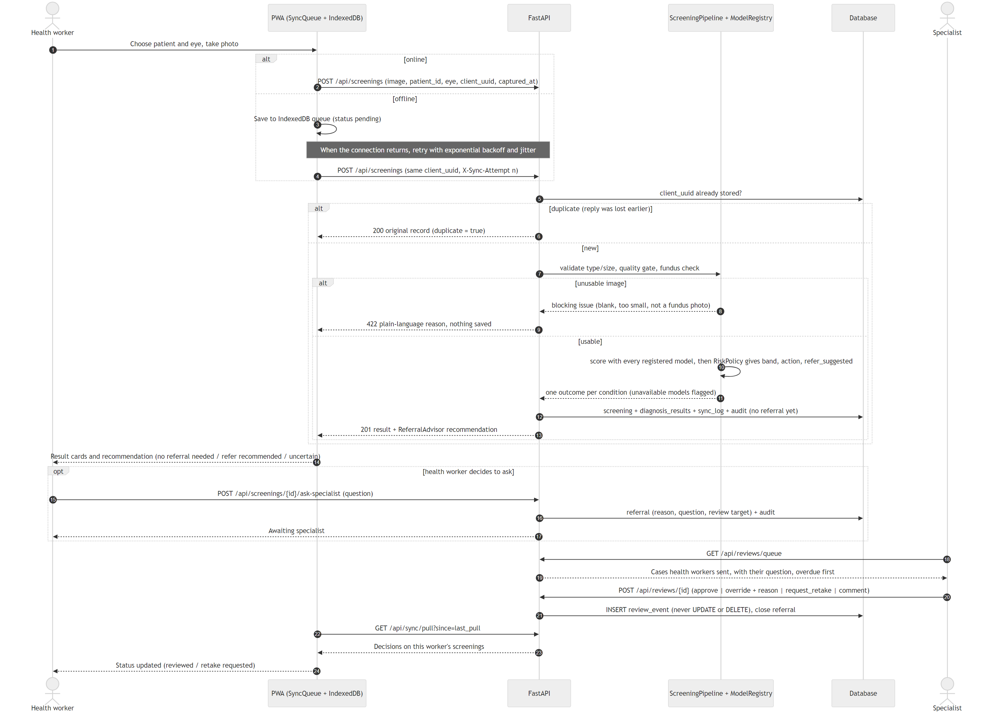

# Architecture and design

All diagrams are generated from Mermaid sources in [diagrams/src/](diagrams/src/) that were written
from the code as it stands (render: `cd frontend; node scripts/render-diagrams.mjs`). The proposal's
diagrams were PlantUML; Mermaid was used here because it renders on GitHub and needs no Java install.

## System architecture

* **Frontend:** a React PWA. Pages read server state only through data hooks, and hooks call one typed
  API client (ESLint forbids `fetch` anywhere else). Captures made offline go to an IndexedDB queue that
  `SyncQueue` pushes when the connection returns.
* **Backend:** FastAPI routers (thin, RBAC-guarded) call services (use cases), which call repositories
  (the only place with SQL). Long-lived objects are built once in `create_app` and injected.
* **ML serving:** `ScreeningPipeline` validates the upload, applies the quality gate, runs every model
  the `ModelRegistry` has verified, and maps each score through that condition's `RiskPolicy`.

## Use cases

## Class design (main abstractions)

| Principle | How it shows up |
|---|---|
| Single responsibility | routers translate HTTP, services hold rules, repositories hold queries, presenters shape responses |
| Open/closed | a new condition model is added by dropping a folder; no class changes |
| Liskov / polymorphism | any `ConditionModel` works in the pipeline; tests substitute a labelled `FixedScoreModel` |
| Interface segregation | `QueueRepository` exposes only what `SyncQueue` needs; `ReviewRepository` has no update/delete |
| Dependency inversion | services receive repositories and the pipeline; the frontend receives `Services` through context |
| Encapsulation | append-only review history is enforced by ORM listeners, not by convention |

## Data model

Differences from the proposal's ERD, made after supervisor feedback: eye laterality and image checksum
on each screening; one `diagnosis_results` row **per condition** with its `model_version` (also for
unavailable models, so history shows what ran); a separate append-only `review_events` table; referrals,
sync logs, refresh tokens and an audit log.

## Main sequence: capture, sync, review, decision returned

## Deviations from the approved proposal

| Proposal | Delivered | Why |
|---|---|---|
| React Native Android app | React PWA, installable on Android and usable on any browser | one codebase for health workers, specialists and admins, testable end to end in one semester; Android remains possible via the same API |
| On-device TFLite inference | Server-side TFLite (LiteRT); offline = capture, queue and sync | reconciles offline use with authentication and central review (supervisor point); in-browser inference left as future work |
| SQLite on device (WatermelonDB/Realm) | IndexedDB on device; SQLite or PostgreSQL on the server | IndexedDB is the browser's native store and can hold image blobs |
| Three disease models | DR, glaucoma and cataract all served | glaucoma and cataract trained later on ODIR-5K (patient-separated split) and added as model folders with no code change; glaucoma is below target and labelled so |
| Load balancer | not implemented | not meaningful for a single-instance prototype; the API is stateless (JWT) so it can be scaled horizontally |
| PlantUML diagrams | Mermaid | renders on GitHub, no Java dependency |
